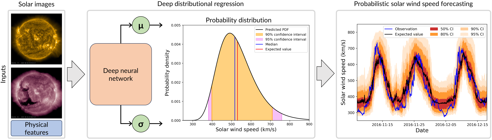
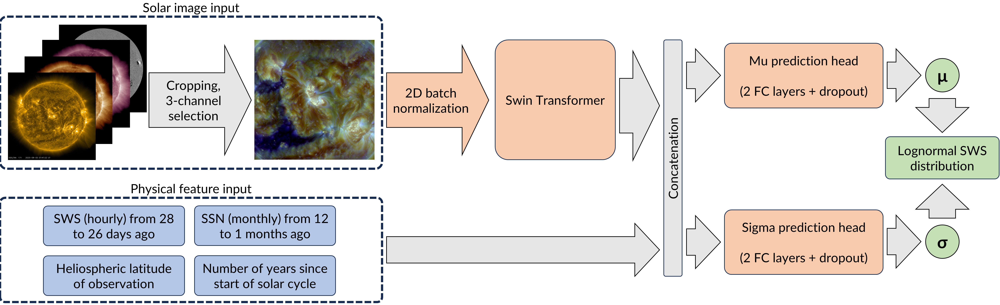

# PROSWIN: Probabilistic Solar Wind Speed Forecasting

Official repository for [PROSWIN: Probabilistic Solar Wind Speed Forecasting Using Deep Distributional Regression From Solar Images](https://doi.org/TBD), published in *TBD* (2026) by [Daniel Collin](https://www.linkedin.com/in/daniel-collin-52abb0205/), [Yuri Shprits](https://www.gfz.de/staff/yuri.shprits), [Luca Chiarabini](https://www.linkedin.com/in/luca-chiarabini-596a07195/) [Stefan J. Hofmeister](https://www.astro.columbia.edu/content/stefan-hofmeister), [Nadja Klein](https://www.kleinlab.de/subpages_team/klein.html) and [Guillermo Gallego](http://www.guillermogallego.es).

<h2 align="left">

[Journal Publication](https://doi.org/TBD) | [Data Publication](https://doi.org/10.5880/GFZ.OJSJ.2026.001) | [Solar Image Repo](https://github.com/DanielCollin96/solar_image_processing)
</h2>


## Citation
If you use this work in your research, please cite it as follows:

```bibtex
@article{Collin2026,
  title   = {PROSWIN: Probabilistic Solar Wind Speed Forecasting Using Deep Distributional Regression From Solar Images},
  author = {Collin, Daniel and Shprits, Yuri and  Chiarabini, Luca and Hofmeister, Stefan J. and Klein, Nadja and Gallego, Guillermo},
  journal = {TBD},
  year    = {2026},
  url     = {https://doi.org/TBD}
}
```

## Framework

<div align="center">
  
</div>

PROSWIN is a probabilistic deep-learning model for forecasting the solar wind speed at L1. It combines SDO/AIA solar images with physical features about solar wind conditions from the previous solar rotation and the state of the solar cycle to predict conditional log-normal distributions of the solar wind speed with a lead time of 4 days. This repository provides code for model training and evaluation of predictions. With the provided [dataset](https://doi.org/10.5880/GFZ.OJSJ.2026.001), all results from the paper can be reproduced.

---

## Table of Contents

1. [Model architecture](#model-architecture)
2. [Installation](#installation)
3. [Dataset preparation](#dataset-preparation)
4. [Repository structure](#repository-structure)
5. [Reproducing the experiments](#reproducing-the-experiments)
6. [Notes for running on multiple GPUs](#running-on-an-hpc-cluster-slurm)
7. [Configuration reference](#configuration-reference)
8. [Citation](#citation)

---

## Model architecture

<div align="center">
  
</div>

PROSWIN consists of an image encoding backbone and two prediction heads, predicting the two distributional parameters mu and sigma of a lognormal distribution.
The model is trained in two sequential stages.


### Backbone
A pretrained Swin Transformer processes stacked solar images and magnetograms. The encoded feature vector is concatenated with the physical feature vector.

### Prediction Heads

Each prediction head of made of two fully-connected neural network layers with dropout. One head predicts the mu parameter and the other one the sigma parameter of the predictive lognormal distribution.

### Two-stage training
| Stage     | Trained part      | Loss                    | Output                                             |
|-----------|-------------------|-------------------------|----------------------------------------------------|
| **mu**    | Image encoder + mu head | Weighted MSE            | Expected solar wind speed value (conditional mean) |
| **sigma** | sigma head | Negative log-likelihood | Conditional lognormal distribution                 |

The image encoder and mu head are frozen during sigma training, 
so the uncertainty estimate is built on top of a fixed point forecast. 
This is possible due to a data transformation, which maps the targets to a normal distribution (log transform), 
such that mean (mu) and variance (sigma) decouple. 
The weighted MSE emphasises high-speed stream events.

### Predictive distribution
Network outputs are in a standardised log-space. Inverting the scaler and re-parameterising yields a shifted log-normal distribution with parameters (shape, scale, loc) compatible with `scipy.stats.lognorm` and `scoringrules`.

### Physical features

- Solar wind speed from the previous solar rotation (hourly values from 28 to 26 days ago)
- Heliospheric latitude of the Earth relative to the equatorial plane of the Sun
- Monthly sunspot numbers over the last year
- Progress of the solar cycle in years

---

## Installation

> **Note:** This project uses [uv](https://github.com/astral-sh/uv) for dependency management. Full `pyproject.toml` and `uv.lock` will be provided in the final release.

### Prerequisites
- Python ≥ 3.10
- For training: CUDA-capable GPU (strongly recommended; CPU-only runs are supported but slow)
- For inference or evaluation: CPU is sufficient
- [uv](https://docs.astral.sh/uv/getting-started/installation/) installed

### Steps

```bash
# 1. Clone the repository
git clone [repository URL]
cd proswin

# 2. Create a virtual environment and install all dependencies
uv sync

# 3. Activate the environment
source .venv/bin/activate   # Linux / macOS
# .venv\Scripts\activate    # Windows
```

The package is installed in editable mode from `src/`, so `import proswin` resolves correctly from any working directory.

### Optional: Weights & Biases experiment tracking

```bash
uv add wandb
wandb login
```

Then set `wandb_project: your_project_name` in `configs/config.yaml`. Leave it blank or omit to disable W&B entirely.

---

## Dataset preparation

The dataset used in the paper is available from GFZ Data Services here: https://doi.org/10.5880/GFZ.OJSJ.2026.001

If you use the dataset for your research, please cite:

```bibtex
@misc{Collin2026dataset,
  title = {Solar Images and Physical Features for Probabilistic Solar Wind Speed Prediction},
  author = {Collin, Daniel and Shprits, Yuri and  Chiarabini, Luca and Hofmeister, Stefan J. and Klein, Nadja and Gallego, Guillermo},
  publisher = {GFZ Data Services},
  year = {2026},
  howpublished = {Data Set},
  doi = {10.5880/GFZ.OJSJ.2026.001}
}
```

### Expected directory layout

After unpacking, update the `paths` section of `configs/config.yaml` to point to the following directories:

```
<data_root>/
├── solar_images/              # SDO/AIA EUV images (.npy, one file per hour)
│   ├── 171/                   # AIA 171 Å channel
│   │   └── <year>/<month>/
│   ├── 193/                   # AIA 193 Å channel
│   ├── 211/                   # AIA 211 Å channel
│   └── HMI/                   # HMI line-of-sight magnetograms
├── machine_learning/        
│   ├── ml_dataset.csv         # Feature values
│   └── literature_models.csv  # Needed for literature comparison
├── physical_features/         # Scalar time series (CSV)
│   ├── solar_wind_speed.csv   # Needed for baseline model comparison
│   ├── sunspot_number.csv     # Needed for solar cycle plot
│   └── ch_area.csv            # Needed for baseline model comparison
└── solar_events/              # Event catalogues (CSV)
    ├── cme_list.csv
    ├── hss_list.csv
    └── enhancement_list.csv

```

### Configure paths

Open `configs/config.yaml` and set each entry under `paths:` to the corresponding directory above. All other paths (results, figures, evaluation outputs) are created automatically on first run.

---

## Repository structure

```
proswin/
├── configs/
│   └── config.yaml                    # Central configuration file (paths, hyperparameters)
├── scripts/                           # Entry-point scripts (run these directly)
│   ├── cross_validation.py            # Full CV training pipeline
│   ├── train_single_split.py          # Single fixed-split training
│   ├── evaluate_predictions.py        # Load & evaluate a saved prediction CSV
│   └── compare_models.py              # Cross-model comparison + figures
└── src/proswin/
    ├── predictions.py                 # Core prediction types (Point, LogNormal, Normal)
    ├── data_management/
    │   ├── solar_dataset.py           # Dataset construction and caching
    │   ├── data_loader_creator.py     # DataLoader factory + output scaler
    │   ├── cv_split_generator.py      # Sequential CV split generation
    │   ├── distribution_transformer.py# Log-space normalisation scaler
    │   ├── physical_data_loader.py    # Physical feature loading utilities
    │   └── cme_filter.py              # CME interval masking utility
    ├── model/
    │   ├── solar_swin_transformer.py  # SwinTransformer backbone + MLP heads
    │   ├── solar_model_trainer.py     # Two-stage trainer (mu → sigma)
    │   ├── cv_runner.py               # Cross-validation orchestration
    │   ├── solar_wind_predictor.py    # Inference wrapper (load model, predict)
    │   └── losses.py                  # Weighted MSE and NLL loss functions
    ├── evaluation/
    │   ├── solar_wind_prediction_evaluator.py  # CRPS, RMSE, Brier, HSS metrics
    │   ├── hss_finder.py              # HSS peak detection and association
    │   ├── baselines.py               # Climatology, persistence, CH regression
    │   ├── model_comparison.py        # Scatter-plot comparison figures
    │   └── plotter.py                 # Time-series and CRPS plotting
    └── utils/
        ├── configurator.py            # Config loader and DDP initialisation
        └── interpolation_dates.py     # Gap detection and linear interpolation
```

---

## Reproducing the experiments

All scripts read exclusively from `configs/config.yaml`. No command-line arguments are used. Edit the config file before each run.

### Step 1 — Configure the experiment

Edit `configs/config.yaml`:
- Set all `paths` entries to your data directories
- Configure the dataset and input data (e.g., image channels) under `dataset`
- Set model hyperparameters and the model's name to identify this run's outputs under `model`
- Set training hyperparameters for the mu and sigma stages under `training`
- Optionally set `wandb_project` for experiment tracking

### Step 2 — Run cross-validated training (primary experiment)

```bash
python scripts/cross_validation.py
```

This runs the complete pipeline:
1. Builds and caches the dataset
2. Generates the 5-fold cross-validation split
3. Trains each fold in two stages (mu then sigma)
4. Evaluates each fold and aggregates predictions across all test periods

**Output files** are written to the directories defined in `configs/config.yaml`:
- `<model_name>_all_folds_predictions.csv` — full test-set predictions
- `<model_name>_cv_metrics_summary.csv` — aggregated evaluation metrics
- `<model_name>_<fold>_<stage>_best.pth` — per-fold model checkpoints

### Step 3 — Compare all channel configurations

This compares all model variants tested in the paper, if the predictions have been downloaded, and generate the metrics and comparison figures.
It also computes the baseline predictions and compares our best model the baselines and to the literature models.

```bash
python scripts/compare_models.py
```

### Step 4 — (Optional) Evaluate a single model

This evaluates the predictions for a single saved model without retraining. Edit `scripts/evaluate_predictions.py` and replace `'test_model'` with your model name.

```bash
python scripts/evaluate_predictions.py
```

### Step 5 — (Optional) Single-split training run

This runs a single training iteration on a fixed train/val/test split. 
Edit `scripts/train_single_split.py` and replace `'train_dates'`, `'val_dates'`, and `'test_dates'` with your the desired training, validation and test dates, respectively.

```bash
python scripts/train_single_split.py
```


---


## Notes for running on multiple GPUs

- `ConfigLoader` reads `RANK`, `LOCAL_RANK`, and `WORLD_SIZE` from the environment automatically. No code changes are needed between single- and multi-GPU runs beyond the config flag.
- Set `training.use_multiple_gpus: false` for single-GPU or CPU-only runs.
- Logging is rank-aware: only rank 0 writes to the logger and W&B.
- DDP is always torn down cleanly via `config.terminate_ddp()` even if training fails.
- The `scripts/compare_models.py` and `scripts/evaluate_predictions.py` scripts do not use DDP and should be run on a single process (no `torchrun`).

---

## Configuration reference

All settings and hyperparameters are configured in `configs/config.yaml`. The file is self-documenting; the table below lists the most commonly changed fields.

| Section | Key | Description                                                                         |
|---|---|-------------------------------------------------------------------------------------|
| `experiment` | `seed` | Global RNG seed (default 42). Set once and do not change to ensure reproducibility. |
| `paths` | `solar_image_dir` | Root directory of SDO/AIA `.npy` image files.                                       |
| `paths` | `solar_event_dir` | Directory containing `cme_list.csv`, `hss_list.csv`, `enhancement_list.csv`.        |
| `paths` | `physical_features_dir` | Directory containing physical feature CSVs.                                         |
| `paths` | `ml_data_dir` | Cache directory for pre-processed dataset tables and CV split pickle.               |
| `paths` | `results` | Root output directory; sub-directories are created automatically.                   |
| `dataset` | `channels` | List of image channels to use, e.g. `['171', '211']`.                               |
| `dataset` | `precompute_and_reuse_dataset` | If `true`, cache the feature table to disk and reuse on subsequent runs.            |
| `model` | `model_name` | String identifier for this run; used as a prefix for all output files.              |
| `model` | `image_encoder` | Swin Transformer variant: `swin_tiny`, `swin_small`, or `swin_base`.                |
| `model` | `mu.hidden_layer_size` / `sigma.hidden_layer_size` | MLP hidden dimension for each prediction head.                                      |
| `model` | `clamp_sigma` / `quantile_to_clamp` | Sigma clamping to prevent degenerate uncertainty estimates.                         |
| `training` | `use_multiple_gpus` | Enable DDP multi-GPU training.                                                      |
| `training` | `wandb_project` | W&B project name. Leave blank to disable tracking.                                  |
| `training` | `fit_prediction_head` | Stages to train: `["mu"]`, `["sigma"]`, or `["mu", "sigma"]`.                       |
| `training` | `mu.learning_rate` / `sigma.learning_rate` | Per-stage learning rates.                                                           |
| `training` | `mu.epochs` / `sigma.epochs` | Maximum epochs per stage.                                                           |
| `training` | `mu.early_stopping_epochs` / `sigma.early_stopping_epochs` | Patience for early stopping.                                                        |
| `training` | `mu.batch_size` / `sigma.batch_size` | Batch size per stage.                                                               |
| `training` | `mu.loss_weights_alpha` / `mu.loss_weights_gamma` | Weighting parameters for exponential weighting of HSSs.           |


---


## Code developer

[Daniel Collin](https://www.linkedin.com/in/daniel-collin-52abb0205/). 

In case of questions or bugs, please contact Daniel at collin@gfz.de.

---


## License

This work is released under [MIT License](https://github.com/DanielCollin96/proswin/blob/main/LICENSE).
